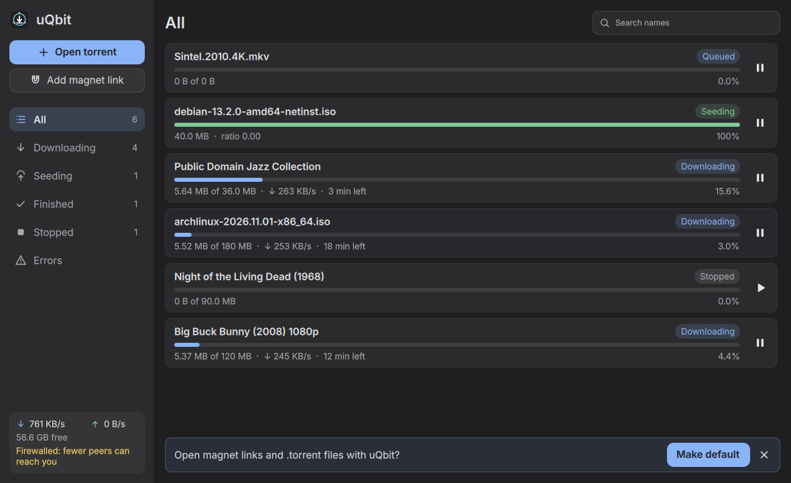
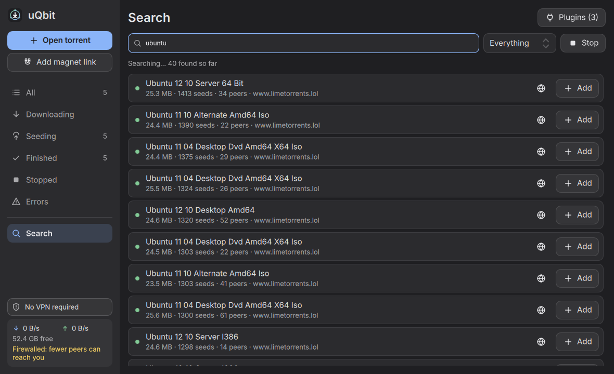
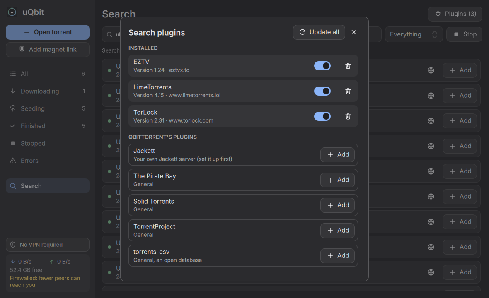
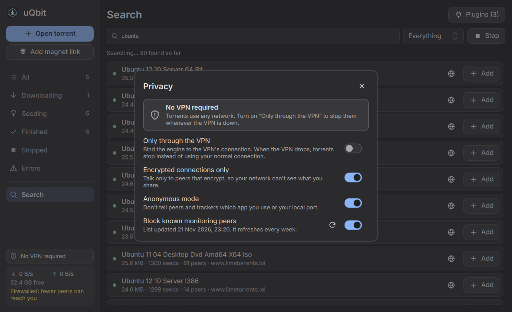
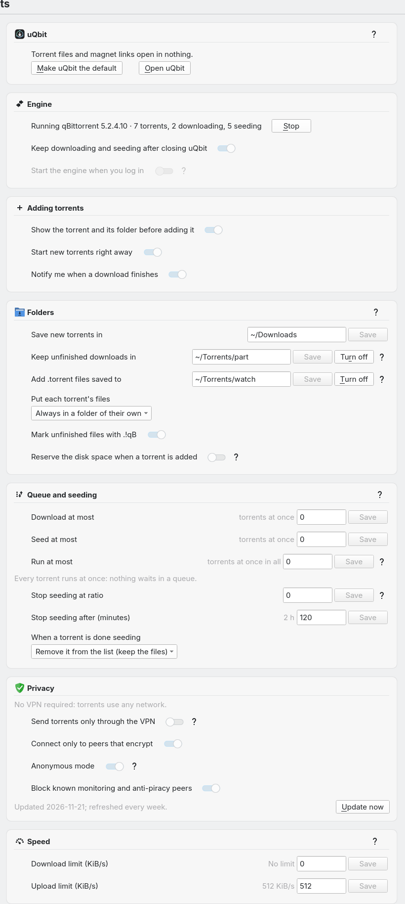
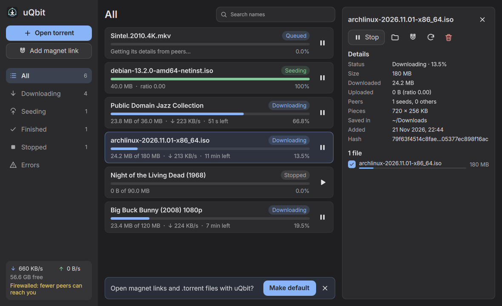
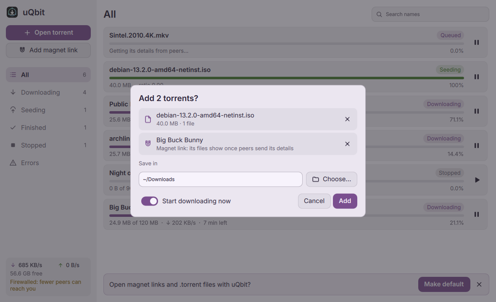

# uQbit

uQ's torrent app: qBittorrent's engine running in the background, driven from a Qt Quick window
that follows the uQ theme.

uQbit doesn't reimplement BitTorrent. It runs `qbittorrent-nox` (or qBittorrent Enhanced
Edition's `qbittorrent-enhanced-nox`) in a profile of its own and talks to it over its Web API
on 127.0.0.1, so you get qBittorrent's engine with a window that looks like the rest of uQ.



## What it does

- **Opens magnet links and .torrent files** from the browser, Files, the command line or a drop
  on the window, and can be the default app for both (`uqbit default set`, or the button in
  the window and in uQ Settings).
- **Add sheet**: the torrent's name, size and file count before it's added, where it saves
  (`~/Downloads` by default) and whether it starts now. Turn it off to add straight away.
- **List**: progress, speed and time left for each torrent, filtered by All, Downloading,
  Seeding, Finished, Stopped and Errors, with search. Totals and free space at the bottom left.
- **Details**: start or stop, open the folder, copy the magnet link, check the files again,
  remove (with or without the files), pick which files to download, trackers.
- **Keeps seeding after the window closes** (or not: a setting), and can start the engine at
  login through a systemd user service (`uqbit-engine.service`).
- **Notifies you when a download finishes**, even with the window closed (the engine runs
  `uqbit notify-finished`).
- **Speed limits and a seeding ratio** that stops a torrent once it has shared enough.
- **One window**: opening a link while uQbit is open adds it in that window.
- **Search** with qBittorrent's search plugins (run by the engine; needs Python 3): results
  sorted by seeds, added with one click. The Plugins sheet installs the official plugins,
  turns them on or off, updates them, removes them, or installs one from an https:// link.
- **Privacy by default**: encryption required, anonymous mode on, and a blocklist of known bad
  peers (refreshed weekly; local and LAN ranges are kept out of it). Change any of it from the
  shield in the sidebar, `uqbit config set` or uQ Settings.
- **VPN only** (off by default): torrents use only the VPN's network interface (WireGuard,
  OpenVPN, Proton, Mullvad and the like, found by itself or fixed with `vpn_interface`). When
  the VPN drops, the engine is bound to an interface that doesn't exist, so nothing leaks;
  torrents carry on when it comes back. The window and the uQ icon show the state.
- **uQ Status icon and quick tile**: speeds, counts and the VPN state in uQ's bar, with pause
  and resume all.
- **uQ Settings page** (Apps › Torrents): default app, engine status with start and stop,
  start on login, adding, folders (save, unfinished, watched), the queue and seeding limits,
  privacy and VPN, speed limits.








## Keys

| Key | Does |
|---|---|
| Ctrl+O | open .torrent files |
| Ctrl+L | add magnet links |
| Ctrl+V | add the magnet links on the clipboard |
| Ctrl+F | search the list (or the search field in Search) |
| Ctrl+K | search with the plugins |
| Space | start / stop the selected torrent |
| Delete | remove the selected torrent |
| Ctrl+1…4 | All, Downloading, Seeding, Finished |
| Esc | close the details |
| Ctrl+Q | quit (the engine keeps running unless you turned that off) |

## Command line

```
uqbit [MAGNET|FILE.torrent|URL]...    open the window (and add these)
uqbit add [--folder DIR] [--stopped] MAGNET|FILE|URL...
uqbit list [--json]                   the torrents, newest first
uqbit engine status|start|stop [--json]
uqbit engine run                      the engine in the foreground (what the systemd unit runs)
uqbit config show [--json]            every setting with its value and default
uqbit config set KEY VALUE            download_folder, ask_before_adding, start_added,
                                      notify_finished, keep_running, start_on_login (true/false),
                                      download_limit, upload_limit (KiB/s, 0 = none),
                                      seed_ratio (0 = never stop), webui_port
uqbit config reset KEY
uqbit default status [--json]         does uQbit open .torrent files and magnet links?
uqbit default set
uqbit status [--json]                 engine, speeds, counts, VPN and privacy (what uQ polls)
uqbit pause-all | resume-all
uqbit show                            open the window
uqbit blocklist status|update [--json]
```

Folder settings: `incomplete_folder`, `watch_folder` (empty = off), `content_layout`
(original/subfolder/no_subfolder), `incomplete_extension`, `preallocate`. Queue and seeding:
`max_active_downloads`, `max_active_uploads`, `max_active_torrents` (0 = no limit), `seed_time`
(minutes), `when_seeded` (stop/remove). `uqbit config show` lists every setting with its help.

Privacy settings: `vpn_only`, `vpn_interface` (empty = find it), `encryption`
(require/prefer/allow), `anonymous_mode`, `blocklist`, `blocklist_url`.

## How it runs the engine

- Profile: `~/.local/share/uqbit` (qBittorrent keeps its own settings, torrents and resume data
  there), so it never shares state with a qBittorrent you run yourself.
- WebUI: 127.0.0.1 only, port 17845 by default (`webui_port`), user `uqbit`, with a random
  password in `~/.local/state/uqbit/webui-password` (mode 0600). uQbit writes its PBKDF2 hash
  into the profile before each start; nothing else in the profile is touched.
- Start: `systemctl --user start uqbit-engine.service` when systemd's user manager is there,
  else `uqbit engine run` detached (log in `~/.local/state/uqbit/engine.log`).
- uQbit's settings (folder, limits, ratio, privacy, the "finished" notification) are pushed to
  the engine when it connects and whenever they change.
- The service restarts the engine if it crashes (at most 5 times in 5 minutes), runs it at low
  priority with memory and task limits, and sandboxes it: no new privileges, no capabilities,
  the system and your home read-only except its profile, uQbit's state folder, the download
  folder and the folders you added torrents to (kept in a drop-in, `uqbit-engine.service.d/
  folders.conf`, that uQbit updates). Adding a torrent to a new folder restarts the engine once
  to let it write there.

## Build

Qt 6.5+ (Core, Gui, Quick, QuickControls2, DBus, Network), zlib and CMake:

```
cmake -B build -G Ninja && cmake --build build && ctest --test-dir build
```

Runtime: `qbittorrent-nox` 4.6 or newer (5.x preferred) or `qbittorrent-enhanced-nox`.
Search needs `python`; VPN detection uses NetworkManager when it's there. On Arch:
`paru -S uqbit` (AUR).

## Licence

GPL-3.0-or-later.
